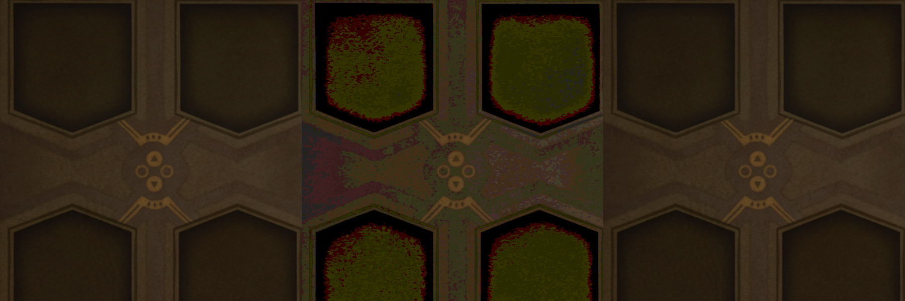

# SDR screenshot comparison

Only this reporter-approved game-image crop is published; no original files,
metadata, settings, logs or machine identifiers are included.

Left: RGB decoded directly from the original straight-alpha PNG.
Middle: the same pixels after an explicit materialized Windows WIC 8-bit
RGBA -> PRGBA -> RGBA conversion.
Right: the same original RGB re-exported by the patched opaque PNG writer.

All panels show RGB on an opaque canvas to expose RGB quantization. The crop
is resized for visual comparison; numerical measurements use native pixels.
The right panel is a controlled re-export, not a later game frame or a newly
captured F7 screenshot. Automated regression fixtures are generated in code.

